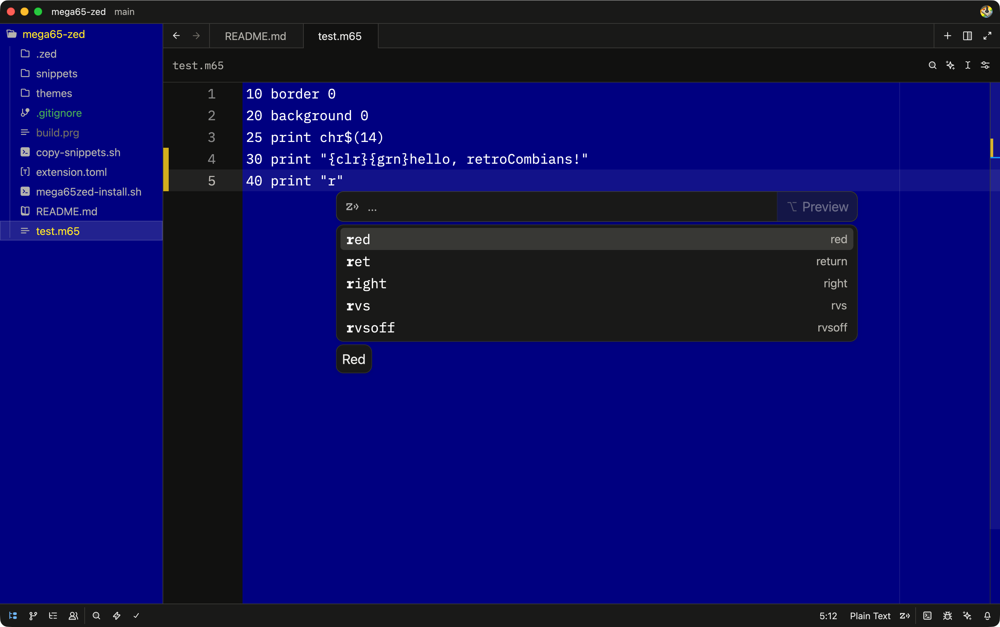

# Commodore BASIC for Zed

**Version 0.7.0.** One Zed extension for three machines:

| File | Language | Dialect | Tokenizer |
|------|----------|---------|-----------|
| `.bas` | Commodore BASIC | BASIC 2.0 (VIC-20 and C64) | `petcat -w2`, load `$0801` |
| `.b65` | BASIC65 | MEGA65 BASIC65 | `petcat -w65`, load `$2001` |
| `.m65` | BASIC65 | same dialect as `.b65` | `petcat -w65`, load `$2001` |

`.m65` stays as an alias so listings you already have, including `color-demo.m65`, keep working. It is not a third dialect. `.bas` used to be accepted as BASIC65 by this repo. It is BASIC 2.0 now. Rename a MEGA65 listing to `.b65` (or leave it as `.m65`).

The extension id is still `mega65`, so an install replaces the old mega65 extension. The display name is **Commodore BASIC**. Syntax highlighting and snippets are in this extension. There is no language server yet.

<p align="center">
  
</p>

## Install the extension

**macOS and Linux.** In Zed: `zed: extensions` → **Install Dev Extension** → this folder.

Before that, uninstall the old dev extensions from [stevencombs/CBM](https://github.com/stevencombs/CBM). They all register the language name `CBM BASIC` and collide with each other:

- `zed/vic20-basic`
- `zed/c64-basic`
- `zed/cbm-basic`

This repo is the one to keep. Themes, in **Zed: Select Theme**:

- **VIC-20 Cyan**
- **C64 Blue**
- **MEGA65 Dark**

Each theme is defined once, in `themes/cbm-machines.json`.

## Install the tools

```bash
chmod +x mega65zed-install.sh scripts/*.sh copy-snippets.sh
./mega65zed-install.sh
```

The installer does **not** install Homebrew, Zed, or Rosetta, and it does not edit only `.zshrc`. It copies `mega65.sh` into `~/.retrocombs-m65/bin` and prepends that directory to `PATH` in `~/.zshrc` and `~/.bashrc` when those files exist. If neither exists, it creates the one that matches your shell. Open a new terminal afterwards.

What it downloads:

- **petcat** from the pinned MEGA65 zip `petcat-20230619`. The binary is chosen by OS and CPU: `macOS-arm`, `macOS-intel`, or `Linux` (x86_64). Linux aarch64 is not in that zip. Install petcat yourself and set `PETCAT`.
- **mega65-tools** (`etherload`, and `m65` / `mega65_ftp` when the archive has them). The script asks GitHub for `MEGA65/mega65-tools` releases and picks the **highest build number** for your OS. `releases/latest` is not a usable tag (the published tag is a prerelease, and an older build is listed first). Set `M65TOOLS_URL` to override. As of this writing that tag has macOS `.7z` assets only. On Linux, copy `etherload` into `~/.retrocombs-m65/bin` or point `ETHERLOAD` at it. Extracting `.7z` needs `7z` or `7zz` already installed.

`etherload.prg` is a BASIC program, not the tool, and is never installed.

## Where tools are looked up

The installer and `scripts/mega65.sh` use the same order:

1. The env var, if you set it: `PETCAT`, `ETHERLOAD`, `XMEGA65` or `XMEGA65_APP`, `X64SC`, `XVIC`, `M65`, `MEGA65_FTP`
2. `PATH`
3. Known locations: `~/.retrocombs-m65/bin` (`CBM_BIN_DIR`), `~/m65tools` (`M65TOOLS`) and `~/m65tools/bin`, `~/.local/bin`, `$(brew --prefix)/bin`, `/opt/homebrew/bin`, `/usr/local/bin`, `/usr/bin`

If `PETCAT` is set but that binary cannot tokenize BASIC65, the script stops instead of silently using a different `petcat`. A `petcat` on `PATH` without `-w65` is skipped only when the file is BASIC65; BASIC 2.0 can use it.

XEMU is the `xmega65` binary, or `xmega65.app` in `/Applications` or `~/Applications`. VICE is `x64sc` and `xvic` on `PATH` (or `X64SC` / `XVIC`). The script does not guess inside `VICE.app` and does not run anything under Rosetta.

## Tasks from any folder

Zed has no extension-directory variable, so the tasks call the installed script:

`$HOME/.retrocombs-m65/bin/mega65.sh`

Those tasks live on the language, so they show up for a `.bas` / `.b65` / `.m65` file in any project once the installer has been run. This repo's `.zed/tasks.json` calls `./scripts/mega65.sh` instead, so the tasks work here before you install. With this folder open you will see both sets.

| Task | Listing | What it does |
|------|---------|----------------|
| **CBM: Check listing** | any | Tokenize only |
| **C64: Run in VICE** | `.bas` | `petcat -w2`, then `x64sc -autostart` |
| **VIC-20: Run in VICE** | `.bas` | `petcat -w2 -l 1001` (unexpanded VIC-20), then `xvic` |
| **MEGA65: Run in XEMU** | `.b65` `.m65` | `petcat -w65`, then `xmega65 -besure -prg` |
| **MEGA65: Push to XEMU** | `.b65` `.m65` | same as Run in XEMU |
| **MEGA65: Push** | any | `etherload` (load, you type `RUN`) |
| **MEGA65: Push+run** / **Send to Hardware** | any | `etherload -r` |

`run` on a `.bas` file is the C64 VICE task. `run` on `.b65` or `.m65` is XEMU. Pushing a `.bas` file is allowed and warned: it is BASIC 2.0 at `$0801`, which is the C64-mode layout, not BASIC65 at `$2001`.

A running emulator is left alone. XEMU and VICE take the PRG at launch, so the script tokenizes, prints the PRG path, and does not quit the emulator. Set `CBM_RESTART_EMULATOR=1` when you want it stopped and started again with the new PRG. `CBM_EMULATOR_DRY_RUN=1` prints the launch and does not start it.

Other overrides: `CBM_BASIC2_LOAD` (default `0801`), `CBM_VIC_LOAD` (default `1001`), `CBM_MEGA65_LOAD` (default `2001`), `CBM_PETCAT_MODE`, `CBM_X64SC_ARGS`, `CBM_XVIC_ARGS`, `CBM_XMEGA65_ARGS`.

PRG files are written to `export/<name>.prg` next to the listing (or next to the parent of a `src/` directory). `build.prg` is still copied beside that for the old name.

## Snippets

Type a prefix and Tab, inside a string for the PETSCII tokens.

- **Commodore BASIC** (`.bas`): cursor and color tokens, F1–F8, `lower` / `upper`. `hello` and `c64hello` insert the C64 HELLO. `vichello` and `vic20hello` insert the unexpanded VIC-20 HELLO. Orange, brown, the greys, and F2/F4/F6/F8 are marked C64 in the description (the VIC-20 does not have them).
- **BASIC65** (`.b65`, `.m65`): the same PETSCII tokens, plus `lower`, `upper`, `10print`, and `graphic`.

Nothing is copied into `~/.config/zed/snippets`. The old `copy-snippets.sh` used to overwrite `plaintext.json`. It no longer does.

```bash
./copy-snippets.sh --remove-stale
```

That deletes these user files if they are present: `cbm basic.json`, `cbm-basic.json`, `mega65 basic.json`, `vic20 basic.json`, `vic-20 basic.json`, `c64 basic.json`, `c64-basic.json`, `plaintext_old.json`, and `snippets.json`. `plaintext.json` is removed only when it still contains the old PETSCII marker `Clear screen + home  CHR$(147)`.

## Highlighting

One tree-sitter grammar, `grammars/tree-sitter-commodore-basic`, covers both dialects. Keywords are case-insensitive and use the Commodore cruncher (`FORI` is `FOR` + `I`, `TOTAL` is `TO` + `TAL`). `REM` comments out the rest of the line. PETSCII `{codes}` are highlighted inside strings.

On a `.bas` file, BASIC65-only words such as `SPEED` and `GRAPHIC` are painted as names, because `petcat -w2` leaves them as text. On a `.b65` or `.m65` file they are keywords.

```bash
./scripts/check-grammar.sh
./scripts/test-tools.sh
```

## Publish

Layout matches a Zed registry extension: `extension.toml` (`schema_version = 1`), languages under `languages/`, the grammar referenced by `repository`, `rev`, and `path`, and an `LICENSE` file. The license in this repo is **MIT**. Change it before you publish if you want something else.

## License

[MIT](LICENSE). Copyright (c) 2026 retroCombs (Steven Combs).
